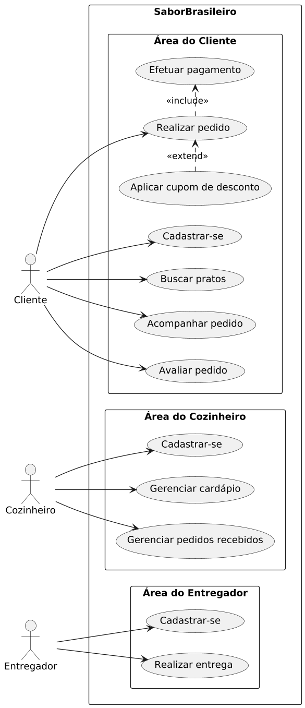
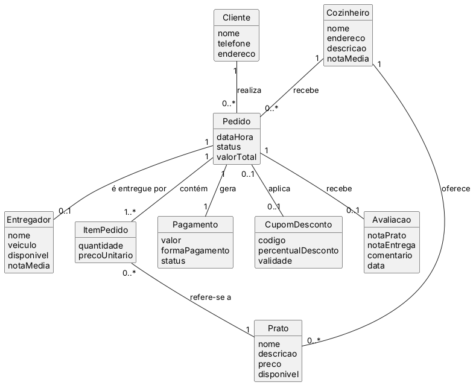

# SaborBrasileiro — Marketplace de Delivery de Comida Caseira

Repositório da Entrega 1 do projeto **SaborBrasileiro**, disciplina de Engenharia de Software.

Esta entrega cobre as seguintes etapas do processo:

1. **Cenário de Negócio e Concepção do Sistema** (com a Declaração de Escopo)
2. **Modelo de Caso de Uso** (atores e diagrama UML em PlantUML)
3. **Modelagem de Negócio** (stakeholders, regras de negócio, modelo de domínio conceitual e fluxo de atividades)
4. **Prototipação** (wireframes de média fidelidade das 10 telas principais)
5. **Especificação de Requisitos** (RF e RNF classificados no modelo FURPS+, com rastreabilidade)
6. **Modelos de Interação com GRASP** (diagramas de sequência e tabelas de justificativa por padrão)
7. **Modularização** (diagramas de componentes com interfaces nomeadas, SRP, DIP, OCP)

## Sobre o projeto

O **SaborBrasileiro** é uma plataforma de marketplace que conecta **cozinheiros caseiros** (pequenos produtores de comida feita em casa) a **clientes** de um bairro ou região, com entrega feita por **entregadores parceiros** cadastrados na plataforma — similar a um iFood, mas focado exclusivamente em comida caseira/artesanal, sem restaurantes formais.

## Estrutura do repositório

```
entrega1-cenario-caso-uso/
├── README.md
├── docs/
│   ├── 01-cenario-negocio-escopo.md   # Cenário de negócio + Declaração de Escopo
│   ├── 02-modelo-caso-uso.md          # Modelo de Caso de Uso
│   ├── 03-modelagem-negocio.md        # Stakeholders, regras de negócio, modelo de domínio
│   ├── 04-prototipacao.md             # Wireframes das 10 telas principais
│   ├── 05-especificacao-requisitos.md # RF e RNF em FURPS+ com rastreabilidade
│   ├── 06-modelo-interacao-grasp.md   # Diagramas de sequência + justificativas GRASP
│   └── 07-diagrama-componentes.md     # Modularização: componentes e interfaces
├── diagramas/
│   ├── diagrama-caso-uso.puml/.png    # Diagrama de casos de uso
│   ├── modelo-dominio.puml/.png       # Diagrama de classes conceitual (modelo de domínio)
│   ├── fluxo-pedido.puml/.png         # Diagrama de atividades do fluxo de pedido
│   ├── seq-01..04-*.puml/.png         # Diagramas de sequência (modelos de interação)
│   └── componentes-*.puml/.png        # Diagramas de componentes (visão geral e detalhado)
└── prototipos/
    └── *.svg                          # Wireframes das 10 telas principais
```

## Diagrama de Caso de Uso



## Modelo de Domínio



## Como visualizar o diagrama PlantUML

O arquivo `diagramas/diagrama-caso-uso.puml` pode ser visualizado de três formas:

- **VS Code**: instale a extensão "PlantUML" (jebbs.plantuml) e use `Alt+D` com o arquivo aberto.
- **Online**: cole o conteúdo do arquivo em https://www.plantuml.com/plantuml/uml/
- **GitHub**: adicionando o arquivo `.puml`, ele é reconhecido como código-fonte; para ver a imagem renderizada direto no README, pode-se usar o serviço [PlantUML Server](https://www.plantuml.com/plantuml) gerando um link de imagem a partir do conteúdo do arquivo.

## Como subir este projeto para o GitHub (direto do VS Code)

1. **Crie o repositório vazio no GitHub**
   - Acesse https://github.com/new
   - Dê um nome (ex: `saborbrasileiro-entrega1`), deixe como público ou privado, **não marque** "Add a README" (você já tem um).
   - Clique em **Create repository** e deixe a página aberta — o GitHub vai te mostrar a URL do repositório (ex: `https://github.com/seu-usuario/saborbrasileiro-entrega1.git`).

2. **Abra a pasta do projeto no VS Code**
   - Extraia o `.zip` recebido em uma pasta no seu computador;
   - No VS Code: `File > Open Folder...` e selecione a pasta `entrega1-cenario-caso-uso`.

3. **Inicialize o Git na pasta**
   - Abra o terminal integrado do VS Code (`Ctrl + '` ou menu `Terminal > New Terminal`);
   - Rode:
     ```bash
     git init
     git add .
     git commit -m "Primeira entrega: cenario de negocio e modelo de caso de uso"
     ```
   - Se for a primeira vez usando Git nesse computador, configure seu nome e e-mail antes do commit:
     ```bash
     git config --global user.name "Seu Nome"
     git config --global user.email "seu-email@exemplo.com"
     ```

4. **Conecte ao repositório remoto do GitHub**
   ```bash
   git branch -M main
   git remote add origin https://github.com/seu-usuario/saborbrasileiro-entrega1.git
   ```
   *(troque a URL pela do seu repositório, copiada no passo 1)*

5. **Envie (push) os arquivos**
   ```bash
   git push -u origin main
   ```
   - Se pedir login, o VS Code costuma abrir uma janela para autenticar sua conta GitHub (ou pode pedir um *Personal Access Token* em vez de senha — o próprio GitHub mostra o link para gerar um em https://github.com/settings/tokens, caso peça).

6. **Confirme no navegador**
   - Atualize a página do repositório no GitHub — os arquivos (`README.md`, `docs/`, `diagramas/`) devem aparecer lá.

### Para próximas atualizações (depois da primeira entrega)

Sempre que editar algo no VS Code, basta repetir:
```bash
git add .
git commit -m "Descreva o que mudou"
git push
```

> Dica: o VS Code também tem uma aba de **Source Control** (ícone de ramificação na barra lateral esquerda) onde dá pra fazer `add`, `commit` e `push` clicando em botões, sem digitar comandos.

## Autor(es)

- Samuel Patto Marcondes Manfredini Ferreira — TIA 32155549

## Disciplina / Professor(a)

Disciplina: Engenharia de Software

Professor(a): _[preencha o nome do(a) professor(a)]_
