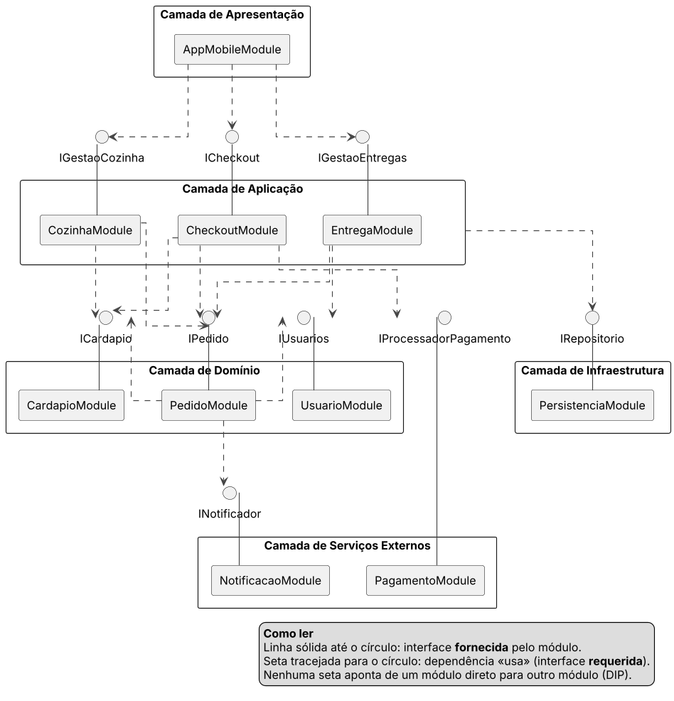
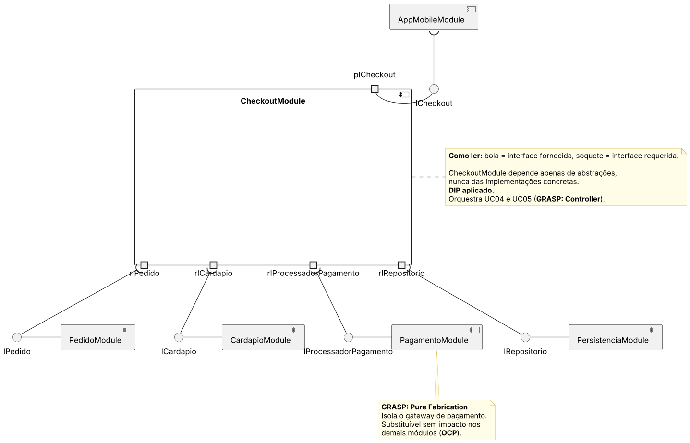

# Modularização e Diagrama de Componentes — SaborBrasileiro

Este documento mostra o SaborBrasileiro em nível **arquitetural**: o sistema decomposto em módulos coesos, as **interfaces nomeadas** entre eles e a aplicação dos princípios **SRP, DIP, OCP** e do padrão GRASP **Low Coupling**. Ele consolida o que foi definido nos [modelos de interação com GRASP](06-modelo-interacao-grasp.md): as classes de design daqueles diagramas (controladores, `ProcessadorPagamento`, `NotificadorStatus`...) agora aparecem agrupadas em componentes.

## 1. Decomposição em componentes

O sistema foi dividido em **10 componentes**, organizados em cinco camadas:

| Componente | Camada | Classes que contém | Casos de uso | Único motivo para mudar (SRP) |
|---|---|---|---|---|
| `AppMobileModule` | Apresentação | Telas dos três perfis ([wireframes](04-prototipacao.md)) | Interface de UC01 a UC09 | O design ou a navegação das telas mudar |
| `CheckoutModule` | Aplicação | `ControladorPedido`, `ControladorAvaliacao` | UC03 (consulta), UC04, UC05, UC08, UC09 | A jornada de compra do cliente mudar |
| `CozinhaModule` | Aplicação | `ControladorCozinha` | UC02, UC06 | O fluxo de trabalho do cozinheiro mudar |
| `EntregaModule` | Aplicação | `ControladorEntrega` | UC07 | O fluxo de trabalho do entregador mudar |
| `PedidoModule` | Domínio | `Pedido`, `ItemPedido`, `CupomDesconto`, `Pagamento`, `Avaliacao` | UC04 a UC09 | Uma regra do ciclo de vida do pedido mudar (RN01, RN02, RN04, RN06, RN08) |
| `CardapioModule` | Domínio | `Prato` | UC02, UC03, UC04 | Uma regra de cardápio mudar (preço, disponibilidade, RN07) |
| `UsuarioModule` | Domínio | `Cliente`, `Cozinheiro`, `Entregador` | UC01, UC07, UC08 | Dados de usuário, nota média ou disponibilidade do entregador mudarem (RN05) |
| `PagamentoModule` | Serviços Externos | `ProcessadorPagamento`, `MeioDePagamento` (`PagamentoCartao`, `PagamentoPix`) | UC05 | A forma de cobrar ou o gateway mudar |
| `NotificacaoModule` | Serviços Externos | `NotificadorStatus` | UC06, UC07, UC09 | O canal de aviso ao cliente mudar |
| `PersistenciaModule` | Infraestrutura | Repositórios | Todos | O banco de dados ou a forma de gravar mudar |

**Escopo:** UC01 (cadastro e login) segue o mesmo padrão dos demais e não foi detalhado nos diagramas, como já ocorreu nos modelos de interação. Numa evolução, ele viraria um módulo de aplicação próprio apoiado em `IUsuarios`.

## 2. Diagrama de visão geral

Fonte: [`diagramas/componentes-visao-geral.puml`](../diagramas/componentes-visao-geral.puml)

**Como ler:** cada camada é um pacote. Uma linha sólida até um círculo indica a interface **fornecida** pelo módulo; uma seta tracejada até o círculo (`«usa»`) indica a interface **requerida**. Não existe nenhuma seta de um módulo direto para outro: toda dependência passa por uma interface nomeada, e as setas apontam sempre **para a abstração**.

Dois pontos de leitura:
- As dependências descem pelas camadas (Apresentação → Aplicação → Domínio → Serviços e Infraestrutura), mas nunca apontam para uma implementação concreta.
- Os módulos de baixo (`CardapioModule`, `UsuarioModule`, `PagamentoModule`, `NotificacaoModule`, `PersistenciaModule`) não requerem nenhuma interface: não dependem de ninguém, o que garante que não há **ciclos de dependência**.

## 3. Interfaces nomeadas e justificativas

| Interface | Fornecida por | Requerida por | Operações principais | Justificativa |
|---|---|---|---|---|
| `ICheckout` | `CheckoutModule` | `AppMobileModule` | `realizarPedido`, `confirmarPagamento`, `avaliarPedido` | Único contrato entre as telas do cliente e a jornada de compra. A interface não sabe que existem `Pedido`, cupom ou pagamento (**Low Coupling**, **DIP**). |
| `IGestaoCozinha` | `CozinhaModule` | `AppMobileModule` | `gerenciarCardapio`, `aceitarPedido`, `recusarPedido` | Contrato próprio do cozinheiro. Separar por ator evita que uma mudança no fluxo do entregador afete a tela do cozinheiro (**ISP**, **SRP**). |
| `IGestaoEntregas` | `EntregaModule` | `AppMobileModule` | `listarEntregas`, `aceitarEntrega` | Contrato próprio do entregador, pelo mesmo motivo. |
| `IPedido` | `PedidoModule` | `CheckoutModule`, `CozinhaModule`, `EntregaModule` | `create`, `adicionarItem`, `aplicarCupom`, `calcularTotal`, `registrarPagamento`, `aceitar`, `atribuirEntregador`, `registrarAvaliacao` | As regras do pedido (RN01, RN02, RN04, RN06, RN08) ficam em um só lugar e os três módulos de aplicação as reutilizam sem duplicar (**Information Expert**). |
| `ICardapio` | `CardapioModule` | `CheckoutModule`, `CozinhaModule`, `PedidoModule` | `buscarPratos`, `estaDisponivel`, `getPreco`, `alterarDisponibilidade` | A disponibilidade e o preço têm um único dono (RN07). Isolar a busca também permite otimizá-la sozinha para cumprir RNF-P01 (até 2 segundos). |
| `IUsuarios` | `UsuarioModule` | `EntregaModule`, `PedidoModule` | `podeAceitarEntrega`, `atualizarMedia` | Quem sabe se o entregador está livre (RN05) e quem mantém a nota média é o módulo de usuários, não os módulos que apenas consultam. |
| `IProcessadorPagamento` | `PagamentoModule` | `CheckoutModule` | `processar(total, meio)` | Isola a integração de pagamento (**Pure Fabrication**, **Protected Variations**). Como o pagamento é simulado nesta versão (RNF-PL02), trocar por um gateway real só muda o módulo que implementa a interface (**OCP**). |
| `INotificador` | `NotificacaoModule` | `PedidoModule` | `notificarMudanca(pedido)` | O `Pedido` avisa qualquer mudança de status sem saber como nem a quem (**Indirection**). |
| `IRepositorio` | `PersistenciaModule` | Camada de Aplicação | `salvar`, `buscarPorId`, `listar` | A aplicação declara que precisa gravar e buscar dados, e a infraestrutura implementa (**DIP**). Trocar o banco de dados não afeta nenhum módulo acima. |

## 4. Diagrama detalhado: `CheckoutModule`

O módulo escolhido para o detalhamento é o `CheckoutModule`, porque orquestra o caso de uso central do sistema (UC04 e UC05, vistos nos diagramas de sequência 1 e 2) e é o que **mais interfaces requer** (quatro), tornando visível a aplicação do DIP.

Fonte: [`diagramas/componentes-detalhado-checkout.puml`](../diagramas/componentes-detalhado-checkout.puml)

**Como ler:** a bola é a interface fornecida e o soquete é a interface requerida. Cada interface sai de uma porta (quadrado) do componente.

| Porta | Tipo | Interface | Ligação com os diagramas de sequência |
|---|---|---|---|
| `pICheckout` | Fornecida | `ICheckout` | Mensagem 1 dos diagramas 1 e 2 (`realizarPedido` e `confirmarPagamento`), enviada pela tela |
| `rIPedido` | Requerida | `IPedido` | Mensagens 2, 3, 7 e 10 do diagrama 1 e mensagens 2 e 5 do diagrama 2 (`create`, `adicionarItem`, `aplicarCupom`, `calcularTotal`, `getTotal`, `registrarPagamento`) |
| `rICardapio` | Requerida | `ICardapio` | Consulta de pratos e verificação de disponibilidade e preço (mensagens 4 e 6 do diagrama 1) |
| `rIProcessadorPagamento` | Requerida | `IProcessadorPagamento` | Mensagem 3 do diagrama 2 (`processar`) |
| `rIRepositorio` | Requerida | `IRepositorio` | Busca e gravação dos objetos, omitidas dos diagramas de sequência (ver nota de escopo do [documento 06](06-modelo-interacao-grasp.md)) |

## 5. Relação com SOLID e GRASP

### SRP — Responsabilidade Única
Cada componente tem **um único motivo para mudar** (última coluna da tabela da seção 1). O teste do enunciado, "se dois componentes mudam sempre juntos, provavelmente estão mal separados", foi aplicado: `PagamentoModule` e `NotificacaoModule` mudam por razões independentes (a forma de cobrar não tem relação com o canal de aviso), assim como os três módulos de aplicação, cada um ligado a um ator diferente.

### DIP — Inversão de Dependência
Os módulos de alto nível nunca dependem diretamente dos de baixo nível. Ambos dependem de uma interface, **declarada por quem precisa dela**:

| Módulo de alto nível | Abstração | Módulo de baixo nível |
|---|---|---|
| `AppMobileModule` | `ICheckout`, `IGestaoCozinha`, `IGestaoEntregas` | Módulos de aplicação |
| `CheckoutModule` | `IProcessadorPagamento` | `PagamentoModule` |
| `PedidoModule` | `INotificador` | `NotificacaoModule` |
| Camada de Aplicação | `IRepositorio` | `PersistenciaModule` |
| `CheckoutModule`, `CozinhaModule`, `EntregaModule` | `IPedido` | `PedidoModule` |

### OCP — Aberto/Fechado
Cada componente pode ser substituído por outro que implemente a mesma interface, sem alterar quem o consome. Três cenários concretos do projeto:

1. **Pagamento real:** trocar a simulação por um gateway (ou acrescentar uma forma como boleto) altera apenas `PagamentoModule`, atrás de `IProcessadorPagamento`.
2. **Novo canal de aviso:** passar a avisar por SMS ou e-mail altera apenas `NotificacaoModule`. O `Pedido` continua chamando `notificarMudanca` do mesmo jeito.
3. **Troca de banco de dados:** altera apenas `PersistenciaModule`, atrás de `IRepositorio`.

### Low Coupling (GRASP)
O acoplamento é medido pela quantidade de interfaces que cada módulo requer:

| Módulo | Interfaces requeridas | Quantidade |
|---|---|---|
| `AppMobileModule` | `ICheckout`, `IGestaoCozinha`, `IGestaoEntregas` | 3 |
| `CheckoutModule` | `IPedido`, `ICardapio`, `IProcessadorPagamento`, `IRepositorio` | 4 |
| `CozinhaModule` | `IPedido`, `ICardapio`, `IRepositorio` | 3 |
| `EntregaModule` | `IPedido`, `IUsuarios`, `IRepositorio` | 3 |
| `PedidoModule` | `ICardapio`, `IUsuarios`, `INotificador` | 3 |
| `CardapioModule`, `UsuarioModule`, `PagamentoModule`, `NotificacaoModule`, `PersistenciaModule` | nenhuma | 0 |

Nenhum módulo requer mais de quatro interfaces, e metade dos módulos não requer nenhuma. O maior acoplamento (`CheckoutModule`, 4) é esperado e justificado: é o orquestrador do caso de uso central.

### Outros padrões GRASP visíveis na arquitetura
- **Controller:** cada módulo de aplicação agrupa os controladores de um ator.
- **Pure Fabrication:** `PagamentoModule`, `NotificacaoModule` e `PersistenciaModule` não representam conceitos do negócio, mas preservam a coesão do domínio.
- **Indirection:** `INotificador` entre o `Pedido` e o aviso ao cliente.
- **Protected Variations:** as interfaces são os pontos estáveis que protegem o sistema das variações de pagamento, canal e banco de dados.

## 6. Decisões de design relevantes

**Por que três módulos de aplicação e não um só?** Um único módulo de aplicação reuniria os fluxos de três atores diferentes, e uma mudança no fluxo do entregador poderia afetar o do cozinheiro. Com um módulo por ator, cada um tem um único motivo para mudar (SRP), expõe uma interface pequena e específica (`ICheckout`, `IGestaoCozinha`, `IGestaoEntregas`) e mantém a coesão dos controladores definidos nos diagramas de sequência.

**Por que o `PedidoModule`, que é de domínio, requer `INotificador`?** Porque a regra "avisar o cliente quando o status mudar" nasce no domínio, mas o *como* avisar não. O domínio declara o que precisa (a interface) e a camada de serviços a implementa. Assim, o domínio continua sem conhecer notificações push, SMS ou qualquer tecnologia, e a seta aponta para a abstração, como o DIP exige.

**Por que a persistência é requerida pela camada de aplicação e não pelo domínio?** Para manter as regras do negócio (`PedidoModule`, `CardapioModule`, `UsuarioModule`) livres de detalhes de armazenamento. Quem precisa buscar e gravar objetos é quem orquestra o caso de uso. Isso deixa o domínio testável sem banco de dados e não cria dependência do domínio com a infraestrutura.

**Por que o `PedidoModule` depende de `ICardapio` e `IUsuarios` em vez dos módulos?** Porque o `Pedido` precisa saber se um prato está disponível e atualizar a nota média de cozinheiros e entregadores, mas não precisa saber *como* esses módulos guardam essas informações. Depender da interface reduz o acoplamento, e como `CardapioModule` e `UsuarioModule` não dependem de ninguém, o diagrama não tem ciclos.

## 7. Rastreabilidade com os requisitos

| Requisito | Como a arquitetura o atende |
|---|---|
| RNF-S02 (separação em camadas) | Cinco camadas: apresentação, aplicação, domínio, serviços externos e infraestrutura. As dependências apontam sempre para interfaces. |
| RNF-PL02 (pagamento simulado) | `PagamentoModule` está atrás de `IProcessadorPagamento`: simulado agora, substituível por um gateway real depois (OCP). |
| RNF-R01 (status do pedido não se perde) | `PersistenciaModule`, via `IRepositorio`, guarda o último status confirmado do pedido. |
| RNF-P01 (busca em até 2 segundos) | A busca está isolada em `CardapioModule`, atrás de `ICardapio`, podendo ser otimizada sem afetar os demais módulos. |
| RF04, RF05, RF08, RF09 | Realizados por `CheckoutModule`, `EntregaModule` e `NotificacaoModule`, conforme a [matriz de rastreabilidade](05-especificacao-requisitos.md). |

---

Ver também: [Cenário de Negócio](01-cenario-negocio-escopo.md), [Modelo de Caso de Uso](02-modelo-caso-uso.md), [Modelagem de Negócio](03-modelagem-negocio.md), [Prototipação](04-prototipacao.md), [Especificação de Requisitos](05-especificacao-requisitos.md) e [Modelos de Interação com GRASP](06-modelo-interacao-grasp.md).
